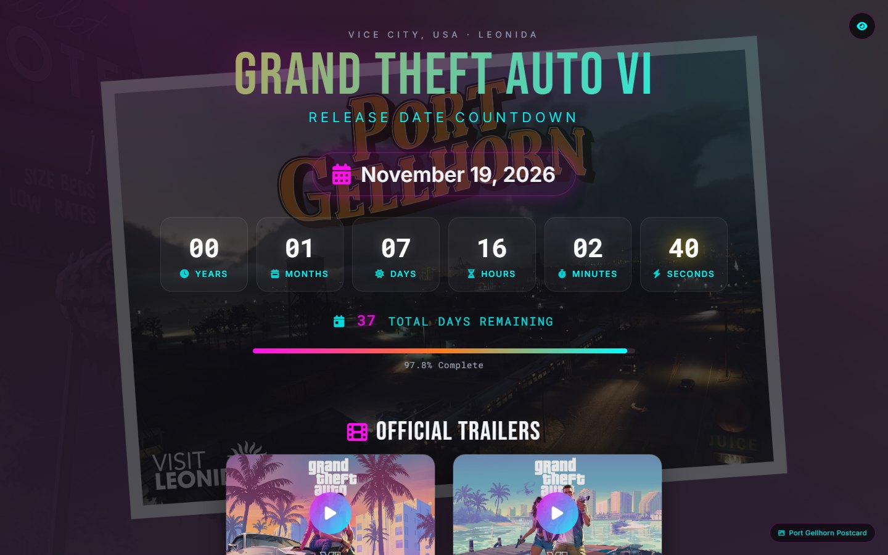
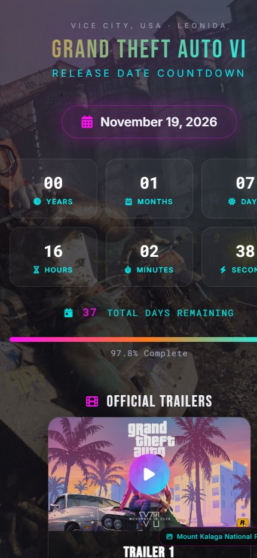

# GTA VI Countdown App


A modern, responsive countdown timer for the Grand Theft Auto VI release date (November 19, 2026), with the official launch trailer and a browsable gallery of 233 images.

## Preview



## 🌐 Live Demo

**Access the app live at:** https://independent-coder.github.io/gta-vi-countdown/

This repository primarily serves as the source code for the GitHub Pages deployment. The app is fully functional and ready to use — no setup required!

## 🎮 Features

- **Live Countdown**: Real-time countdown showing years, months, days, hours, minutes, and seconds until GTA VI release
- **Total Days Display**: Additional smaller display showing total remaining days
- **Progress Tracking**: Visual progress bar showing completion percentage from announcement to release
- **Preload Countdown**: Separate live countdown to the November 12, 2026 game preload date
- **Official Trailers**: Embedded YouTube trailer cards for Trailer 1, Trailer 2, *An Extended Look* and the October 15, 2026 Launch Trailer
- **Official Links**: Direct links to the GTA VI merch collection, official music and latest trailer news
- **Media Gallery**: Browse all **233 official images** — 139 screenshots, 27 artwork & wallpapers, 51 Ultimate Edition benefit images, 12 Vintage Vice City Pack images and 4 music images — filterable by category and grouped by character/location
- **Character Browser**: Browse character cards first, then open an individual character to see their screenshots
- **Collapsible Gallery**: Hide or reveal the gallery with an accessible slide animation
- **Custom Backgrounds**: Set any gallery image as the background; automatic rotation pauses until resumed
- **Lightbox Viewer**: Click any gallery image to open a full-resolution viewer with keyboard and arrow navigation
- **Lightweight Gallery**: 560px thumbnails loaded with native lazy loading keep the 233-image grid fast
- **Dynamic Background System**: All 233 official GTA VI images hosted locally, rotating every 30 seconds
- **Randomized Display**: Images shuffle randomly for a unique viewing experience
- **Preloaded Images**: Upcoming backgrounds are preloaded for stutter-free transitions
- **Background Info Display**: Shows the current background image name
- **Responsive Layout**: Fully responsive design that works on desktop, tablet, and mobile
- **Smooth Animations**: Tasteful transitions, hover effects, and micro-interactions
- **Motivational Quotes**: Rotating quotes that change every 10 seconds to keep the hype alive
- **Interactive Elements**: Click countdown items for visual feedback
- **Release Celebration**: Special confetti animation when countdown reaches zero
- **Accessible**: Keyboard navigation, focus states, ARIA labels and reduced-motion support
- **Toggle Countdown**: Button to hide/show the countdown for better image viewing
- **Professional Disclaimer**: Legal disclaimers for trademark and copyright compliance

## 🚀 GitHub Pages Setup

This repository is optimized for GitHub Pages deployment. The app is already live and working!

### For Your Own Deployment:

1. **Fork this repository**
2. **Enable GitHub Pages** in your fork's settings:
   - Go to Settings → Pages
   - Source: Deploy from a branch
   - Branch: `main` → `/ (root)`
   - Save
3. **Access your app** at: `https://[your-username].github.io/gta-vi-countdown/`

## 🛠️ Technologies Used

- **HTML5**: Semantic markup and modern structure
- **CSS3**: Grid, Flexbox, custom properties, animations, `prefers-reduced-motion`
- **ES6 Modules**: Modular JavaScript architecture with imports/exports
- **Vanilla JavaScript**: No frameworks required — pure, modern JavaScript
- **Google Fonts**: Bebas Neue, Inter and Roboto Mono
- **Font Awesome**: Icons throughout the interface
- **Pillow (build time only)**: Generates the gallery thumbnails and re-encodes the full-size images

## 📱 Browser Support

- Chrome 88+
- Firefox 89+
- Safari 15.4+
- Edge 88+

These minimums reflect the CSS features the interface relies on (`aspect-ratio`, `inset`, `:focus-visible` and `backdrop-filter`). Older browsers will still render the page, but some layout and focus styling may degrade.

## 🎨 Customization (Optional)

While the app is ready to use as-is, you can customize it in `js/config.js`:

### Changing Target Date
```javascript
export const CONFIG = {
    TARGET_DATE: new Date('November 19, 2026 00:00:00').getTime(),
    START_DATE: new Date('February 4, 2022 00:00:00').getTime(),
    // ...
};
```

### Modifying Colors
Update the design tokens at the top of `styles.css`:
```css
:root {
    --pink: #ff10f0;   /* primary accent */
    --cyan: #00ffff;   /* secondary accent */
    --orange: #ff7a1a; /* sunset accent */
}
```

### Background Images
The app hosts official GTA VI media locally. Images live in `assets/backgrounds/` and gallery thumbnails in `assets/thumbs/`, with matching relative paths. Add a file to both folders and list it in `BACKGROUND_IMAGES` inside `js/config.js`.

Full-resolution images are stored as progressive JPEGs at 3840x2160. Regenerate a thumbnail for every new image, and only re-encode (quality 85, progressive, optimized) if it actually shrinks the source — some sources, such as Rockstar's own website images, are already optimized and will grow instead.

Media is grouped by folder:

- `characters/` and `locations/` — the 139 official screenshots
- `artworks/` — the 27 official artwork & wallpapers
- `ultimate-edition/` — the 51 Ultimate Edition benefit images
- `vintage-vice-city/` — the 12 Vintage Vice City Pack images
- `music/` — 4 official backgrounds from the music section

**Note**: The source images are pulled from Rockstar's own media downloads to avoid CDN rate limits. They are used for display purposes only.

**Repository size**: roughly 213 MB of full-size JPEGs plus ~7 MB of thumbnails (about 220 MB total), so this repository is intentionally asset-heavy. Fork and deploy accordingly.

### Toggle Countdown
The eye button in the top-right corner allows users to:
- Hide the countdown interface for better image viewing
- Show the countdown interface when needed
- Background rotation continues regardless of visibility state

## 📁 Project Structure

```
gta-vi-countdown/
├── index.html                 # Main HTML: hero, countdown, trailers, links, gallery, lightbox
├── styles.css                 # Design tokens, layout, gallery, lightbox, responsive rules
├── js/                        # Modular JavaScript components
│   ├── app.js                 # Application entry point and interval wiring
│   ├── config.js              # Configuration, quotes, official links, trailers, image lists
│   ├── media-utils.js         # Name formatting and URL helpers
│   ├── device-detector.js     # Device detection and optimization
│   ├── background-manager.js  # Rotating background image management
│   ├── countdown-timer.js     # Countdown timer and progress logic
│   ├── gallery.js             # Gallery grid, filters and lightbox
│   └── ui-manager.js          # Trailers, official links and UI interactions
├── assets/
│   ├── backgrounds/           # 233 official GTA VI images (5 categories, see above)
│   ├── thumbs/                # Web-optimized gallery thumbnails
│   ├── favicon.png
│   └── og-image.png
├── screenshots/               # README preview images
├── README.md                  # This file
├── CHANGELOG.md               # Version history and changes
├── LICENSE                    # MIT License
└── .gitignore                 # Git ignore file
```

## 🔗 Links

- **Live App**: https://independent-coder.github.io/gta-vi-countdown/
- **GitHub Repository**: https://github.com/Independent-Coder/gta-vi-countdown
- **GTA VI Launch Trailer (October 2026)**: https://www.youtube.com/watch?v=rz1B4B2yBZY
- **GTA VI: An Extended Look (trailer)**: https://www.youtube.com/watch?v=tJbzMqJGH4k
- **GTA VI Merch Collection**: https://store.rockstargames.com/merchandise/gtavi-goodtime-state-vice-city-collection
- **GTA VI Official Music**: https://www.rockstargames.com/VI/music
- **Rockstar Games Media**: https://www.rockstargames.com/VI/media
- **GTA VI Official Trailer - December 2023**: https://www.youtube.com/watch?v=QdBZY2fkU-0
- **GTA VI Official Trailer 2 - May 2025**: https://www.youtube.com/watch?v=VQRLujxTm3c
- **Rockstar Games Twitter**: https://twitter.com/RockstarGames

## 📅 Future Updates

I'll do my best to keep this countdown updated when major announcements drop! This includes:

- **Release Date Changes**: Updating the countdown target date if Rockstar announces delays
- **New Media**: Adding new official screenshots or artwork as they are published

*Note: Updates depend on official Rockstar Games announcements and my availability to implement changes promptly.*

## 📄 License

This project is open source and available under [MIT License](LICENSE).

---

⚠️ **Disclaimer**: This is a fan-made countdown timer. The release date is based on official announcements from Rockstar Games and may be subject to change. Not affiliated with Rockstar Games. Grand Theft Auto VI is a trademark of Take-Two Interactive Software. The images are used for display purposes only and are not distributed for commercial use. The images are the property of Rockstar Games and Take-Two Interactive Software.

*Made with ❤️ by GTA fans, for GTA fans*
